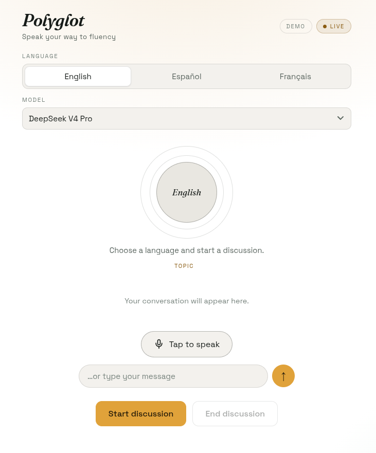

# Polyglot — voice language tutor



A small, self-contained web app for practicing spoken **English / Spanish / French**
by having a voice conversation with an AI tutor. You talk into your microphone,
the tutor replies — in the target language, out loud.

The server is written in **Go** (standard library only — no external dependencies).

## Features

- **Web app** with a language selector (English · Español · Français) and a model selector.
- **Start discussion** / **End discussion** buttons.
- **Microphone input** — speech recognition via the browser's Web Speech API.
- **Voice from the server** — text-to-speech is generated server-side and streamed
  back as audio (keyless Google Translate TTS by default, or OpenAI TTS).
- **Go agent backend** that picks a **new topic every session** and keeps the
  conversation going with a friendly, short-reply tutor persona.
- **Multiple models**, defaulting to `deepseek-v4-pro`:
  - DeepSeek (`deepseek-v4-pro`, `deepseek-chat`)
  - OpenAI (`gpt-4o`, `gpt-4o-mini`)
  - Anthropic (`claude-3-5-haiku-latest`, `claude-3-7-sonnet-latest`)
  - Ollama (`llama3.2`, local)
  - A built-in offline **demo tutor** (no API key required)

## Run it

Requires **Go 1.22+**.

```bash
go build -o ailanglearn .
./ailanglearn
```

Then open <http://localhost:8080>. There is nothing else to install — the web
assets are embedded in the binary.

> The demo tutor works with **no API key**. Set the keys below to use real models.

## Configuration

All settings come from environment variables (see `.env.example`):

| Variable | Default | Purpose |
| --- | --- | --- |
| `PORT` | `8080` | HTTP port |
| `LLM_MODEL` | `deepseek-v4-pro` | Default model shown in the UI |
| `DEEPSEEK_API_BASE` | `https://api.deepseek.com` | DeepSeek base URL |
| `DEEPSEEK_API_KEY` | — | DeepSeek API key |
| `OPENAI_API_BASE` | `https://api.openai.com/v1` | OpenAI base URL |
| `OPENAI_API_KEY` | — | OpenAI API key |
| `ANTHROPIC_API_BASE` | `https://api.anthropic.com` | Anthropic base URL |
| `ANTHROPIC_API_KEY` | — | Anthropic API key |
| `OLLAMA_BASE` | `http://localhost:11434` | Local Ollama base URL |
| `TTS_PROVIDER` | `google` | `google` (keyless) · `openai` · `mock` |
| `TTS_API_BASE` / `TTS_API_KEY` / `TTS_MODEL` / `TTS_VOICE` | — | Used when `TTS_PROVIDER=openai` |
| `STT_SILENCE_SECONDS` | `5` | Seconds of silence before your spoken turn is finalized |
| `PROMPTS_DIR` | *(embedded)* | Directory with `tutor_system.txt`, `topic_system.txt`, `topic_user.txt` that overrides the embedded prompts |

### Prompt templates

The agent's entire behavior is driven by three small text files in `prompts/`:

| File | Role |
| --- | --- |
| `tutor_system.txt` | The tutor's persona and the rules it follows on **every** reply. |
| `topic_system.txt` | Instruction for the topic generator ("reply with JSON only"). |
| `topic_user.txt` | The topic request itself — what kind of topic to pick. |

Templates use `{{Placeholder}}` tokens: `{{Language}}`, `{{Topic}}`,
`{{Opening}}`, and `{{RecentTopics}}` are substituted at runtime.

You can edit these to make the agent whatever you need — it is not limited to
casual conversation. Change the persona in `tutor_system.txt` (and optionally
the topic request in `topic_user.txt`) and the same voice UI becomes an
interviewer, a presentation audience, or anything else.

To edit without rebuilding, point `PROMPTS_DIR` at a folder containing the same
three files (validated at startup, so a missing file fails fast):

```bash
PROMPTS_DIR=/path/to/my-prompts ./ailanglearn
```

#### Example: job interview practice

Replace the rules in `tutor_system.txt` with an interviewer persona:

```text
You are a friendly but professional interviewer conducting a job interview in {{Language}}.
Ask one behavioral question at a time, follow up on the learner's answers, and keep every reply to 1-3 sentences in {{Language}}.
Occasionally note, in {{Language}}, how the learner could phrase an answer more naturally.
```

Then make `topic_user.txt` request interview questions instead of casual topics:

```text
Target language: {{Language}}.
Recently used topics to avoid: {{RecentTopics}}.

Propose ONE fresh job-interview question suitable for speaking practice, plus a short opening line in {{Language}}.

Reply with ONLY a JSON object in exactly this shape (no markdown fences, no extra text):
{"topic":"<short topic phrase in English>","greeting":"<the greeting, entirely in {{Language}}>"}
```

#### Example: project / presentation practice

Make the agent an audience that questions your talk:

```text
You are an attentive audience member listening to the learner rehearse a project presentation in {{Language}}.
Ask clarifying questions about the project's goal, approach, and results — one at a time, in 1-3 sentences of {{Language}}.
If the learner loses clarity, gently ask them to restate in {{Language}}.
```

#### Example: relaxed small talk (the default)

Keep `tutor_system.txt` close to the shipped version: a warm tutor that stays
on a casual topic, keeps replies short, and asks one follow-up question at a
time.

General tips:

- Keep replies short — this is a **voice** app, so 1–3 sentences read best aloud.
- Always tell it to stay in `{{Language}}` and to end with one question.
- If you want feedback on mistakes, say so explicitly (e.g. "gently rephrase
  major mistakes in your next sentence").
- A new topic is picked every session, so describe the *category* of topic you
  want (interview questions, presentation critiques, travel small talk, …) in
  `topic_user.txt` rather than a single fixed subject.

### A note on `deepseek-v4-pro`

`deepseek-v4-pro` is the default model id. The server treats DeepSeek as an
OpenAI-compatible endpoint, so you can point it at any compatible gateway:

```bash
# DeepSeek's public API (use their model name):
DEEPSEEK_API_KEY=sk-... LLM_MODEL=deepseek-chat ./ailanglearn

# Any OpenAI-compatible gateway serving deepseek-v4-pro:
DEEPSEEK_API_BASE=https://your-gateway DEEPSEEK_API_KEY=... LLM_MODEL=deepseek-v4-pro ./ailanglearn
```

If a selected model's provider has no key configured, the server automatically
falls back to the offline demo tutor and the UI shows a small **demo** badge.

## How it works

- `POST /api/session/start` creates a session and generates a **fresh topic**
  (the agent avoids recently used topics), returning a greeting in the target
  language that is spoken aloud.
- `POST /api/session/message` sends your transcribed speech to the model and
  returns the tutor's short reply.
- `POST /api/session/end` closes the session.
- `POST /api/tts` renders any text to audio on the server.

### Browser notes

- **Speech recognition** uses the browser's Web Speech API, which is available in
  Chrome and Edge (and needs an internet connection). The app shows a typed-input
  fallback everywhere, so it works even without a microphone.
- Your spoken turn ends after `STT_SILENCE_SECONDS` (default 5) of silence rather
  than the browser's short pause, so you can take your time between phrases.
- If server TTS is unavailable, the app falls back to the browser's built-in
  speech synthesis.

## Project layout

```
main.go                  entry point (embeds web/ and prompts/)
internal/voicechat/
  run.go                 bootstrap: config, wiring, server startup
  config.go              env config, language/model registry
  server.go              HTTP API + static file serving
  agent.go               sessions, tutor persona, topic generation
  llm.go                 model providers (DeepSeek/OpenAI/Anthropic/Ollama/demo)
  tts.go                 server-side text-to-speech
  topics.go              curated fallback topics per language
  prompts.go             prompt template loading and rendering
web/                     frontend (index.html, style.css, app.js)
prompts/                 prompt templates (*.txt)
```
